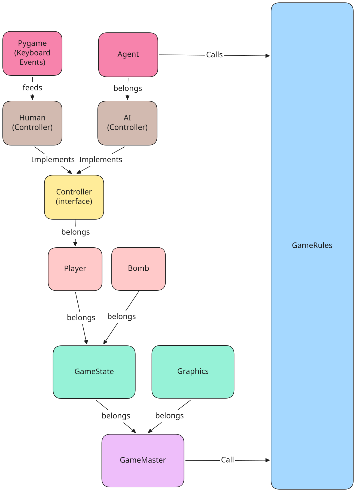

# 💣 DynamiteMan

Implementação de um jogo estilo **Bomberman** em Python com **Pygame**, desenvolvido com arquitetura desacoplada (**Ports & Adapters / Hexagonal**) para suportar tanto jogadores humanos quanto agentes de Inteligência Artificial (Fundamentos de IA).

---

## 🏗️ Arquitetura de Alto Nível



O projeto separa completamente o **estado do jogo (`Gamestate`)**, o **motor de regras (`GameRules`)**, a **renderização gráfica (`Graphic`)** e os **controladores (`Controller`)**, permitindo que agentes de IA simulem estados e tomem decisões usando a mesma interface de um jogador humano.

```text
DynamiteMan/
├── agents/                  # Implementações futuras de Agentes de IA
├── core/
│   ├── commands/
│   │   └── gamerules.py     # Motor de regras, física, colisões e explosões
│   ├── controllers/
│   │   └── human.py         # Controladores Human (teclado) e IdleController
│   ├── entities/
│   │   ├── bomb.py          # Entidade Bomba
│   │   └── player.py        # Entidade Jogador
│   ├── gateways/
│   │   └── graphic.py       # Motor de renderização em Pygame
│   ├── ports/
│   │   └── controller.py    # Interface abstrata (Port) para qualquer Controller
│   └── vos/                 # Value Objects (Objetos de Valor)
│       ├── action.py        # Enum de ações (UP, DOWN, LEFT, RIGHT, BOMB, IDLE)
│       ├── direction.py     # Enum de direção visual (UP, DOWN, LEFT, RIGHT)
│       ├── gamestate.py     # Estado completo da partida por tick
│       ├── position.py      # Posição 2D contínua (float) e discreta (grid)
│       └── walls.py         # Tipos de célula do mapa (EMPTY, CONCRETE, BOX)
├── docs/images/             # Diagramas de arquitetura
├── src/                     # Sprites e assets gráficos (64x64)
├── main.py                  # Ponto de entrada e Game Loop principal (60 FPS)
└── requirements.txt         # Dependências do projeto
```

---

## 🚀 Como Executar

1. **Crie e ative um ambiente virtual (opcional, mas recomendado):**
   ```bash
   python -m venv .venv
   # Windows:
   .venv\Scripts\activate
   # Linux/macOS:
   source .venv/bin/activate
   ```

2. **Instale as dependências:**
   ```bash
   pip install -r requirements.txt
   ```

3. **Inicie o jogo:**
   ```bash
   python main.py
   ```

---

## 🎮 Controles (Player 1)

| Tecla | Ação |
| :--- | :--- |
| `W`, `A`, `S`, `D` ou `Setas` | Movimentar o personagem |
| `ESPAÇO` | Plantar bomba |

---

## 📚 Documentação dos Módulos e Funções

### 1. Value Objects (`core/vos/`)
* **`Action` (`core/vos/action.py`)**: Enum com as ações possíveis em cada tick (`UP`, `DOWN`, `LEFT`, `RIGHT`, `BOMB`, `IDLE`).
* **`Direction` (`core/vos/direction.py`)**: `StrEnum` que define para qual direção o sprite do personagem está olhando (`UP`, `DOWN`, `LEFT`, `RIGHT`).
* **`Wall` (`core/vos/walls.py`)**: Enum dos tipos de terreno do mapa:
  * `EMPTY`: piso livre;
  * `CONCRETE`: parede indestrutível (bloqueia movimento e chamas);
  * `BOX`: caixa destrutível (bloqueia movimento, mas é destruída ao ser atingida por fogo).
* **`Position` (`core/vos/position.py`)**: Dataclass imutável com coordenadas contínuas (`x: float`, `y: float`):
  * `grid() -> tuple[int, int]`: retorna a célula inteira mais próxima `(round(x), round(y))` na matriz.
  * `tuple() -> tuple[float, float]`: retorna a tupla `(x, y)` exata.
* **`Gamestate` (`core/vos/gamestate.py`)**: Dataclass que armazena o estado completo da partida:
  * `width`, `height`: dimensões da matriz do mapa (`9x9`);
  * `grid_walls`: matriz `list[list[Wall]]` com o cenário atual;
  * `flames_grid`: matriz `list[list[int]]` com o tempo restante de fogo em cada célula (`-1` = sem fogo);
  * `current_tick`: contador de ticks decorridos;
  * `bombs`: lista de bombas ativas (`list[Bomb]`);
  * `players`: lista de jogadores (`list[Player]`).

### 2. Entidades (`core/entities/`)
* **`Player` (`core/entities/player.py`)**: Representa cada jogador na arena, contendo `id`, `pos`, `facing`, `alive`, `speed`, `bomb_capacity`, `active_bombs` e seu `controller`.
* **`Bomb` (`core/entities/bomb.py`)**: Representa uma bomba plantada, contendo `id`, `owner_id`, `pos`, `fuse_ticks` (pavio padrão de `120` ticks / 2 segundos) e `blast_radius` (alcance padrão de `2` células).

### 3. Portas e Controladores (`core/ports/` e `core/controllers/`)
* **`Controller` (`core/ports/controller.py`)**: Interface base abstrata com o contrato `get_actions(state: Gamestate, player_id: int) -> list[Action]`.
* **`Human` (`core/controllers/human.py`)**: Implementa `Controller` lendo as teclas pressionadas via Pygame e retornando a lista de `Action` correspondentes.
* **`IdleController` (`core/controllers/human.py`)**: Controlador placeholder que retorna `[Action.IDLE]` para manter outros bonecos parados quando não controlados por IA.

### 4. Regras do Jogo e Física (`core/commands/gamerules.py`)
* **`is_flame(gs, x, y) -> bool`**: Verifica se a célula `(x, y)` possui fogo ativo (`flames_grid[y][x] >= 0`).
* **`process_fires(gs) -> None`**: Decrementa os ticks de todas as células em chamas até apagarem (`-1`).
* **`explode_bomb(gs, bomb) -> None`**: Detona a bomba, devolve `1` de munição (`active_bombs`) ao jogador dono e propaga o fogo em cruz até `blast_radius` (parando em `Wall.CONCRETE`, destruindo a primeira `Wall.BOX` de cada direção e acionando reação em cadeia caso atinja outra bomba).
* **`process_bombs(gs) -> None`**: Decrementa o `fuse_ticks` das bombas ativas e detona todas as que chegaram a `<= 0` (incluindo explosões em cadeia no mesmo tick).
* **`is_walkable(gs, x, y, player) -> bool`**: Valida se o jogador pode pisar na célula `(x, y)`, checando limites do mapa, paredes/caixas, colisão com outros jogadores vivos e bombas (permitindo que o jogador saia de cima da bomba que acabou de plantar antes de ela se tornar sólida).
* **`try_move(gs, player, dx, dy) -> bool`**: Executa a movimentação contínua (`STEP_SIZE * speed`) com **Corner Sliding** (deslizamento automático em quinas quando o jogador está até `45%` desalinhado com a entrada de um corredor).
* **`plant_bomb(gs, player) -> None`**: Planta uma bomba na célula `player.pos.grid()` caso o jogador tenha capacidade disponível e a célula ainda não possua bomba.
* **`update_gamestate(gs) -> None`**: Avança a simulação completa do jogo em 1 tick (fogos, bombas, ações dos jogadores e verificação de morte por fogo).

### 5. Renderização (`core/gateways/graphic.py`)
* **`Graphic`**: Gerencia a janela do Pygame e o carregamento de texturas.
  * `draw(gs)`: renderiza em ordem: mapa (`draw_grid`), bombas (`draw_bombs`), explosões (`draw_fire`) e jogadores vivos (`draw_players`).